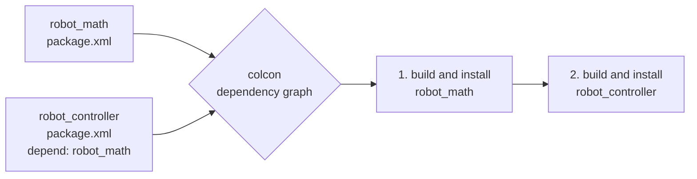
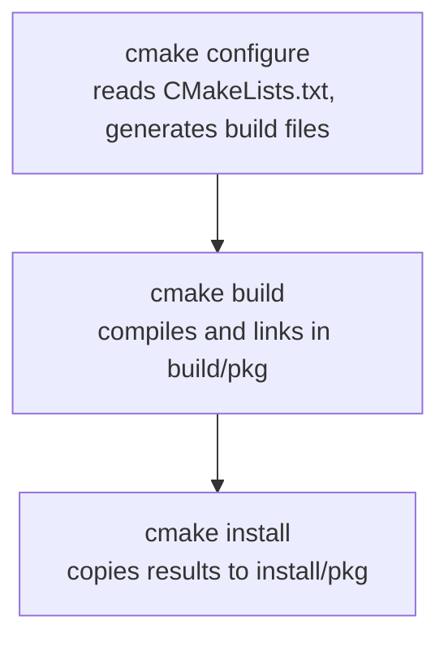
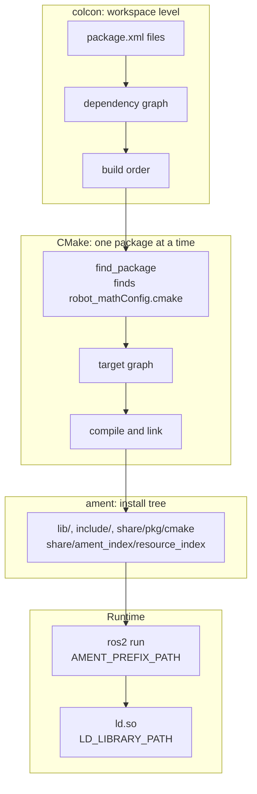

When you run `colcon build` in a ROS 2 workspace, how does ROS know which packages to build first, where to find their dependencies, and how to link everything together?

The short answer is that ROS 2 does not have its own compiler, linker or build system. It coordinates existing tools, and each tool owns one narrow job. Most of the confusing errors (`Could not find a package configuration file`, `error while loading shared libraries`, `package 'x' not found`) come from mixing up which tool is responsible for what.

This post follows one small example from `package.xml` to a running executable, and shows what each layer actually does. It assumes you already use `colcon build` and have written a `CMakeLists.txt`, and that you want to understand the mechanics behind them.

## Who does what

Five components take part between your source files and a running node.

| Component | Responsibility |
| --- | --- |
| **colcon** | Package discovery, dependency ordering and build orchestration |
| **CMake** | Build configuration and target dependencies |
| **ament_cmake** | ROS 2 package integration: exports, install layout, metadata |
| **Compiler and linker** | Object files and binary linking |
| **ament index** | Package discovery at runtime |

The key idea of this post is that there are **three separate mechanisms**, each with its own "graph":

1. colcon's **package dependency graph**, built from `package.xml`, which decides the build order.
2. CMake's **target graph**, built from `CMakeLists.txt`, which decides what is compiled and linked.
3. The **ament index**, a set of marker files in the install tree, which decides how packages are found at runtime.

They look related, but none of them is derived from another. Keeping them apart is what makes the build system understandable.

## A running example: two dependent packages

I will use the same two packages in every section.

```text
ros2_ws/
└── src/
    ├── robot_math/
    │   ├── package.xml
    │   ├── CMakeLists.txt
    │   ├── include/robot_math/clamp.hpp
    │   └── src/clamp.cpp
    │
    └── robot_controller/
        ├── package.xml
        ├── CMakeLists.txt
        └── src/main.cpp
```

`robot_math` builds a shared library, `librobot_math.so`, with a single function. `robot_controller` builds an executable, `controller_node`, that calls it.

```cpp
// robot_math/include/robot_math/clamp.hpp
#pragma once
namespace robot_math { double clamp(double v, double lo, double hi); }
```

```cpp
// robot_controller/src/main.cpp
#include <iostream>
#include "robot_math/clamp.hpp"

int main() { std::cout << robot_math::clamp(12.0, 0.0, 10.0) << "\n"; }
```

The thread of the article is two questions. How does ROS 2 know it must build `robot_math` before `robot_controller`? And once both are built, how does the executable find the library at runtime?


The terminal outputs below come from a real build of this exact layout, done with plain CMake and the same install layout that `ament_cmake` produces. ament adds metadata and environment files on top, but the compile, link and load steps are identical. Paths are shortened to `/tmp/exp`.


## Package discovery: the role of `package.xml`

The first thing `colcon build` does is look for packages. It walks the workspace (by default the current directory) and asks a set of identification extensions whether a directory is a package. For ROS packages, the extension reads `package.xml`, takes the package name and the declared build type, and records the dependencies.

`robot_controller` declares its dependency on `robot_math` like this:

```xml
<package format="3">
  <name>robot_controller</name>
  <version>0.1.0</version>
  <description>Controller using robot_math</description>
  <maintainer email="me@example.com">Me</maintainer>
  <license>Apache-2.0</license>

  <buildtool_depend>ament_cmake</buildtool_depend>
  <depend>robot_math</depend>

  <export>
    <build_type>ament_cmake</build_type>
  </export>
</package>
```

The `<export><build_type>` tag is how colcon knows which build task to use. The `<depend>` tag is a shortcut for three kinds of dependency: build, build export and execution.

This declaration **links nothing**. No include path, no library, no compiler flag comes from `package.xml`. Its purpose is to feed colcon's dependency graph, and to feed tools such as `rosdep`, which install missing system dependencies.

You can look at the graph colcon has built:

```bash
colcon list --topological-order --names-only
# robot_math
# robot_controller

colcon graph
```

From that graph, colcon computes a **topological order**: a package is only built once everything it depends on, inside the workspace, has been built and installed. Dependencies that are not in the workspace (`rclcpp`, `std_msgs`, ...) are ignored for ordering, because they are expected to come from an underlay such as `/opt/ros/<distro>`, which you source before building.



*Figure 1. From `package.xml` files to a build order.*

A common mistake is to forget the `<depend>` while the CMake code works fine on your machine. If `robot_controller` has `find_package(robot_math)` but no `<depend>`, colcon sees two independent packages and may build them in parallel, in any order. It works one time, and fails on a clean machine.

## Build orchestration: what colcon executes

colcon does not compile anything. It plans the work and delegates it to **build tasks**, selected by each package's build type. For an `ament_cmake` package the task does three things:



*Figure 2. The three phases for each `ament_cmake` package.*

Each package gets its own directories:

```text
ros2_ws/
├── build/
│   ├── robot_math/          # CMake build tree, object files
│   └── robot_controller/
├── install/
│   ├── robot_math/          # what other packages and the runtime use
│   ├── robot_controller/
│   └── setup.bash           # the script you source
└── log/
    └── latest_build/robot_math/   # command.log, stdout_stderr.log, ...
```

Three consequences are worth knowing.

- **Isolation.** By default (without `--merge-install`) every package installs into its own prefix, `install/<package>`. A package cannot accidentally see another package's files unless colcon puts that prefix in its environment, and colcon only does this for declared dependencies.
- **Parallelism.** Independent packages are built in parallel. Dependencies in `package.xml` are the only thing preventing a package from starting too early.
- **Environment.** Before building `robot_controller`, colcon prepares an environment that contains the install prefixes of its dependencies. It does this with small hook scripts that each package installs. This is what makes `CMAKE_PREFIX_PATH` and `AMENT_PREFIX_PATH` contain `install/robot_math` at the right moment.

That last point answers a question many tutorials skip: **how can `find_package(robot_math)` find a package that colcon built a few seconds ago?** Because colcon adds `install/robot_math` to `CMAKE_PREFIX_PATH` for the build of `robot_controller`, and CMake searches that variable. The next section shows what it finds there.

To see the exact commands, read `log/latest_build/robot_controller/command.log`, or run:

```bash
colcon build --event-handlers console_direct+ --packages-select robot_controller
```

## CMake: from source files to linked binaries

This is the heart of the build. CMake reads `CMakeLists.txt` and builds a graph of **targets** (libraries and executables), with their properties: sources, include directories, link dependencies. It then generates native build files (Makefiles or Ninja), and the real compiler is invoked from those.

Here is the build of `controller_node`, with the commands taken from a verbose build:

```text
c++ -isystem /tmp/exp/install/robot_math/include/robot_math \
    -o CMakeFiles/controller_node.dir/src/main.cpp.o -c src/main.cpp

c++ CMakeFiles/controller_node.dir/src/main.cpp.o -o controller_node \
    -Wl,-rpath,/tmp/exp/install/robot_math/lib: \
    /tmp/exp/install/robot_math/lib/librobot_math.so
```

The two commands correspond to two different steps.

```text
main.cpp
   ↓ preprocessor      (#include "robot_math/clamp.hpp" is resolved with -isystem)
translation unit
   ↓ compiler
main.cpp.o             (calls to robot_math::clamp are left as unresolved symbols)
   ↓ linker + librobot_math.so
controller_node
```

**Compilation** only needs the header. It produces `main.cpp.o`, where the call to `robot_math::clamp` is recorded as an *undefined symbol*. You can see it in the final executable:

```bash
nm -D --undefined-only controller_node | grep clamp
#                  U _ZN10robot_math5clampEddd

nm -DC --defined-only librobot_math.so | grep clamp
# 00000000000010f9 T robot_math::clamp(double, double, double)
```

The executable needs the symbol (`U`), the library defines it (`T`). The `_ZN10robot_math5clampEddd` string is the mangled C++ name, and `-C` demangles it.

**Linking** joins the pieces. With a *static* library (`add_library(... STATIC)`) the linker would copy the needed code into the executable. With a *shared* library, as here, it only records a dependency: the executable will ask the dynamic loader for `librobot_math.so` when it starts. This is the usual choice in ROS 2, and it is required for things like component libraries and plugins that are loaded at runtime.

### `find_package()` is not `target_link_libraries()`

These two commands are often written side by side, which hides that they do very different things.

```cmake
find_package(robot_math REQUIRED)                          # 1
add_executable(controller_node src/main.cpp)
target_link_libraries(controller_node PUBLIC robot_math::robot_math)   # 2
```

- `find_package()` **discovers a package configuration** and runs it. It searches `CMAKE_PREFIX_PATH` for a file named `robot_mathConfig.cmake`, and executing that file *creates* the imported target `robot_math::robot_math`. Nothing is linked yet.
- `target_link_libraries()` **declares a link dependency** of one target on another. Because `robot_math::robot_math` carries its include directory and its library path as properties, linking against it brings both the `-isystem` flag and the `.so` path seen above. The keyword (`PUBLIC`, `PRIVATE`, `INTERFACE`) states whether consumers of `controller_node` inherit that dependency.

So the first command makes a name available, and the second one uses it.

## ament_cmake: making CMake packages work together

CMake alone can already export targets, so why do we need `ament_cmake`? Because CMake does not know about the conventions that make a *ROS 2 package* a package: a package name registered somewhere, a `package.xml` installed next to the files, environment files so that a shell can use the install, and a consistent way to export both targets and their own dependencies.

This is `robot_math/CMakeLists.txt`:

```cmake
cmake_minimum_required(VERSION 3.16)
project(robot_math)

find_package(ament_cmake REQUIRED)

add_library(robot_math SHARED src/clamp.cpp)
target_include_directories(robot_math PUBLIC
  $<BUILD_INTERFACE:${CMAKE_CURRENT_SOURCE_DIR}/include>
  $<INSTALL_INTERFACE:include/${PROJECT_NAME}>)

install(DIRECTORY include/ DESTINATION include/${PROJECT_NAME})
install(TARGETS robot_math EXPORT export_robot_math
  LIBRARY DESTINATION lib
  ARCHIVE DESTINATION lib
  RUNTIME DESTINATION bin)

ament_export_targets(export_robot_math HAS_LIBRARY_TARGET)
ament_package()
```

And this is `robot_controller/CMakeLists.txt`:

```cmake
cmake_minimum_required(VERSION 3.16)
project(robot_controller)

find_package(ament_cmake REQUIRED)
find_package(robot_math REQUIRED)

add_executable(controller_node src/main.cpp)
target_link_libraries(controller_node PUBLIC robot_math::robot_math)

install(TARGETS controller_node DESTINATION lib/${PROJECT_NAME})

ament_package()
```

The macros that matter here:

- **`ament_export_targets()`** exports the CMake targets of the package, so that `find_package(robot_math)` later recreates `robot_math::robot_math`. `HAS_LIBRARY_TARGET` also registers the environment hook that puts the package's `lib` directory in the library search path (more on that in the runtime section below).
- **`ament_export_dependencies()`** records the packages that consumers need to find too. If the public headers of `robot_math` include Eigen, you add `ament_export_dependencies(Eigen3)` so that `find_package(robot_math)` also runs `find_package(Eigen3)` for its users.
- **`ament_package()`** must be the **last** call. It generates and installs the package files: the `robot_mathConfig.cmake` entry point, the copy of `package.xml`, the environment hooks, and the ament index markers described in the next section.
- **`ament_target_dependencies()`** was the historical way to consume another package, by setting include directories and libraries from CMake variables. It is now deprecated, starting with the Kilted release, in favour of `target_link_libraries()` with imported targets, as used above.

After `colcon build`, the install tree of `robot_math` looks like this (the `Config.cmake` files are the ones relevant for CMake):

```text
install/robot_math/
├── include/robot_math/robot_math/clamp.hpp
├── lib/librobot_math.so
└── share/robot_math/
    ├── cmake/
    │   ├── robot_mathConfig.cmake      # entry point of find_package
    │   └── ...                         # exported targets, extras
    ├── package.xml
    └── local_setup.bash, hook/ ...     # environment scripts
```

When `robot_controller` calls `find_package(robot_math)`, CMake tries `<prefix>/share/<name>*/cmake/<name>Config.cmake` for every prefix in `CMAKE_PREFIX_PATH`. `install/robot_math` is one of them, so it finds `share/robot_math/cmake/robot_mathConfig.cmake`. That file defines the imported target, with its `INTERFACE_INCLUDE_DIRECTORIES` pointing to `install/robot_math/include/robot_math` and its `IMPORTED_LOCATION` to `install/robot_math/lib/librobot_math.so`. The `-isystem` flag and the library path in the previous section were read from exactly these properties.


`package.xml` does not link two packages. It tells **colcon** the build order. The link is done by **CMake**, through an exported target found in the install tree of the dependency.


## The ament resource index: finding packages at runtime

`find_package()` finds packages at *build time*, for CMake. At *runtime* you need another mechanism, because ROS 2 tools do not run CMake. `ros2 run`, launch files and `get_package_share_directory()` all ask a simpler question: where is the package `robot_math` installed?

`ament_package()` answers it by installing **marker files** into a standard directory, the *ament resource index*:

```text
install/robot_math/share/ament_index/resource_index/
├── packages/robot_math                  # empty file: "this prefix contains robot_math"
├── package_run_dependencies/robot_math  # its run dependencies
└── parent_prefix_path/robot_math        # prefixes this package was built on top of
```

The `packages` marker is usually an empty file. Its **existence** is the information.

The lookup works with the environment variable `AMENT_PREFIX_PATH`, a list of install prefixes (it is what `source install/setup.bash` extends). To resolve a package, the ament index code goes through each prefix and checks whether `<prefix>/share/ament_index/resource_index/packages/<name>` exists. The first prefix that has it is the answer.

```python
from ament_index_python.packages import get_package_share_directory

get_package_share_directory("robot_math")
# '/home/me/ros2_ws/install/robot_math/share/robot_math'
```

This is why the call is cheap and reliable. It does not scan the workspace and it does not parse any `package.xml`: it does a handful of file-existence checks. The same index is used for other things, such as registered plugins and message interfaces, each in its own resource type.

It is important to keep the two discovery mechanisms apart.

| | CMake discovery | ROS 2 discovery |
| --- | --- | --- |
| Used by | `find_package()` at build time | `ros2 run`, launch, `get_package_share_directory()` |
| Looks in | `CMAKE_PREFIX_PATH` | `AMENT_PREFIX_PATH` |
| Looks for | `<name>Config.cmake` | `resource_index/packages/<name>` |
| Gives | Imported targets and variables | A prefix and share directory |

Both variables are filled from the same place, the install prefixes, which is why they usually agree. But they are independent, and a package can be visible to one without the other.

## From build time to runtime: how Linux loads the libraries

Once everything is installed, you run:

```bash
source install/setup.bash
ros2 run robot_controller controller_node
```

`ros2 run` first uses the ament index to find the prefix of `robot_controller`. It then looks for the executable in `lib/robot_controller/`, which is why the `CMakeLists.txt` installed the target with `DESTINATION lib/${PROJECT_NAME}`. After that, ROS is out of the picture: it is the Linux kernel and the dynamic loader (`ld.so`) that start the program.

The executable does not contain the path of the library, only its **name**. The `NEEDED` entries of the ELF file are called `DT_NEEDED`:

```bash
readelf -d install/robot_controller/lib/robot_controller/controller_node | grep -E 'NEEDED|RPATH|RUNPATH'
#  (NEEDED)   Shared library: [librobot_math.so]
#  (NEEDED)   Shared library: [libstdc++.so.6]
#  (NEEDED)   Shared library: [libc.so.6]
```

For each name, the loader searches the following places, in order:

1. `DT_RPATH` of the executable (only when there is no `DT_RUNPATH`),
2. the `LD_LIBRARY_PATH` environment variable,
3. `DT_RUNPATH` of the executable,
4. the cache `/etc/ld.so.cache`,
5. the default directories, such as `/lib` and `/usr/lib`.

Now compare the two binaries from my build. The one in the **build tree** has a `RUNPATH`, added by CMake so that you can run it directly after building:

```bash
readelf -d build/robot_controller/controller_node | grep RUNPATH
#  (RUNPATH)  Library runpath: [/tmp/exp/install/robot_math/lib:]
```

The one in the **install tree** has none: CMake removes the build path when installing. So, in a fresh terminal, the library is not found:

```bash
ldd install/robot_controller/lib/robot_controller/controller_node | grep robot_math
#  librobot_math.so => not found

install/robot_controller/lib/robot_controller/controller_node
# error while loading shared libraries: librobot_math.so: cannot open shared object file
```

And with the install prefix in `LD_LIBRARY_PATH`, it works:

```bash
LD_LIBRARY_PATH=/tmp/exp/install/robot_math/lib ./controller_node
# 10
```

That is exactly what `source install/setup.bash` does for you. Each package installs a small hook that prepends its `lib` directory to `LD_LIBRARY_PATH` (this is the hook that `HAS_LIBRARY_TARGET` registers), and `setup.bash` runs all of them. In other words, the usual ROS 2 workspace relies on the **environment** to find shared libraries, not on paths written inside the binaries.

This also explains a classic symptom: a node that runs in the terminal where you sourced the workspace, but fails from a `systemd` service, a Docker `CMD` or an IDE launcher. The binary is fine, the environment is not. You can instead embed the paths with `CMAKE_INSTALL_RPATH`, which is sometimes the right choice for a deployed application, but it is not the default ROS 2 behaviour.

## Putting everything together

The whole chain, from the workspace to a running process, is shown below.



*Figure 3. The full chain, with the three separate mechanisms in colcon, CMake and the ament index.*

With this picture, three questions that most tutorials leave open have short answers.

- **Why isn't `package.xml` enough to link two packages?** Because colcon and CMake use different graphs. `package.xml` gives colcon the order of the build. The linking is described by CMake targets, and a missing `find_package()` or `target_link_libraries()` leaves the link undone even if the dependency is declared.
- **How does `find_package()` locate a package that colcon just built?** colcon puts the install prefix of each declared dependency in `CMAKE_PREFIX_PATH`, and the installed `robot_mathConfig.cmake` is found there. If the dependency was not declared in `package.xml`, this prefix may be missing.
- **Why do we need `ament_package()` if CMake already supports libraries and installation?** CMake can build, install and export targets. It does not register the package in the ament index, install the environment hooks or export dependencies in the ROS 2 way. Without `ament_package()`, the code compiles, but `ros2 run` cannot find the package.


Three mechanisms, three questions. **colcon** decides *in which order* to build, **CMake** decides *what to link to what*, and the **ament index** plus the **environment** decide *where things are found at runtime*. When a build breaks, first ask which of the three is failing.


## Where to go next

- The [colcon documentation](https://colcon.readthedocs.io/) describes the discovery, identification and build task extensions in detail.
- The [ament_cmake user documentation](https://docs.ros.org/en/rolling/How-To-Guides/Ament-CMake-Documentation.html) covers the macros used here, including exporting targets and dependencies.
- The [CMake `find_package` reference](https://cmake.org/cmake/help/latest/command/find_package.html) lists every location searched for configuration files.
